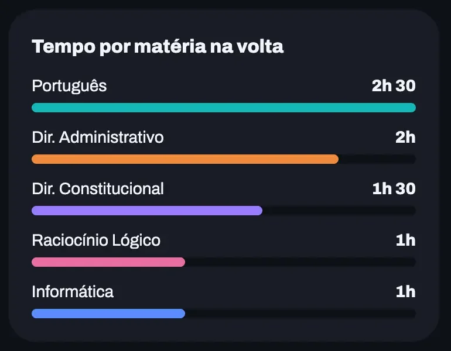

Segunda era dia de português e constitucional. Logo de manhã, o chefe pediu um relatório para ontem, e você chegou em casa às dez da noite sem cabeça para nada.

Na terça, a planilha mandava estudar penal e raciocínio lógico. E português? Ficou para a semana que vem, junto com a sensação de estar devendo.

Para quem estuda sozinho e trabalha, essa cena se repete muito. O ciclo de estudos resolve o problema tirando as matérias dos dias da semana: você segue uma lista na ordem, e o dia ruim só atrasa a fila, sem bagunçar o resto.

Em quatro linhas:

- Ciclo de estudos é uma lista de matérias, com horas, estudada sempre na mesma ordem.
- Faltou um dia? Você continua de onde parou, sem matéria atrasada.
- Matéria que pesa mais no edital aparece mais vezes ou com mais horas.
- Quando a lista termina, você fecha a volta e recomeça do primeiro item.

## O que é ciclo de estudos?

Ciclo de estudos é uma forma de organizar o estudo em que as matérias ficam numa lista, cada uma com um tempo, e você estuda sempre a próxima da lista, sem amarrar matéria a dia da semana. Quando chega ao fim, completou uma volta e começa outra.

O cronograma semanal diz "terça é dia de direito penal". O ciclo diz só "depois de português vem direito penal, por 2 horas". Se a terça foi corrida, o direito penal espera a quarta. Se sobrou tempo na quarta, você já começa a matéria seguinte.

A grade fixa funciona bem na escola e no cursinho, onde o horário de aula já vem pronto. Quando o estudo divide o dia com o trabalho, ela costuma quebrar no primeiro imprevisto.

## Ciclo ou cronograma semanal?

O ciclo é melhor para quem tem horários irregulares, e o cronograma semanal funciona para quem tem uma rotina previsível. A diferença aparece nos dias que fogem do plano:

| Situação | Cronograma semanal | Ciclo de estudos |
|---|---|---|
| Faltou um dia | As matérias do dia ficam atrasadas | Você continua do ponto onde parou |
| Sobrou tempo | Adiantar bagunça o dia seguinte | Você segue para a próxima matéria |
| Matéria com mais peso | Precisa caber em dias fixos | Ganha mais horas ou aparece mais vezes |
| Controle | Data por data, na planilha | Só a próxima da lista e o quanto falta |
| Para quem funciona | Rotina fixa, como a do cursinho | Quem trabalha ou tem semanas irregulares |

O ciclo também alterna as matérias naturalmente. Cada uma volta depois de alguns dias, e isso ajuda a memória: estudar o mesmo conteúdo em dias diferentes rende mais do que concentrar tudo de uma vez, como o Caio explicou no artigo sobre [como memorizar o que estudo](/blog/como-memorizar-o-que-estudo).

## Como montar seu ciclo

Para montar um ciclo de estudos, defina quantas horas você tem por semana, liste as matérias do edital com o peso de cada uma, distribua as horas pelo peso e pela sua dificuldade, quebre em blocos de 30 minutos a 2 horas e siga a lista na ordem.

### 1. Conte as horas reais da semana

Some o tempo que você consegue estudar de verdade numa semana normal, e não numa semana ideal. Se nos dias úteis você tem 1 hora e no sábado tem 3, são 8 horas. É esse total que a primeira volta do ciclo vai ter.

### 2. Liste as matérias e o peso no edital

Pegue o edital (ou o do último concurso do cargo) e anote cada matéria com o número de questões ou o peso. Se ainda não escolheu o concurso, comece pelo artigo sobre [como começar a estudar para concurso](/blog/dicas-para-iniciantes-emconcursos). Para o ENEM, as quatro áreas têm 45 questões cada, e a redação entra à parte.

### 3. Distribua as horas

Dê mais horas para o que pesa mais e para o que você tem mais dificuldade. Um jeito simples: dê de 1 a 3 pontos para o peso e de 1 a 3 para a dificuldade, some e divida as horas na proporção dos pontos. Um exemplo com 8 horas para um concurso de tribunal:

| Matéria | Peso | Dificuldade | Horas na volta |
|---|---|---|---|
| Português | 3 | 3 | 2h 30 |
| Direito administrativo | 3 | 2 | 2h |
| Direito constitucional | 2 | 2 | 1h 30 |
| Raciocínio lógico | 1 | 2 | 1h |
| Informática | 1 | 1 | 1h |

Arredonde para blocos fáceis de lembrar. A conta é um ponto de partida: depois de duas ou três voltas, você ajusta pelo que viu nas questões.

### 4. Quebre em blocos e intercale

Matéria com mais de 2 horas vira dois blocos, em lugares diferentes da lista. No exemplo, português aparece duas vezes: 1h 30 no começo e 1h no fim. Evite blocos de menos de 30 minutos, que mal dão tempo de engrenar, e alterne matérias de leitura com as de cálculo quando puder.

### 5. Siga na ordem e feche a volta

Estude sempre o próximo item. Terminou o bloco, marque como feito. Quando todos estiverem feitos, a volta fechou: comece outra do primeiro item. A volta não precisa caber numa semana exata. Pode levar seis dias numa semana tranquila e dez numa semana de prova no trabalho.

## O ciclo no Estugram

No [Estugram](https://estugram.com), o ciclo é uma lista em que você adiciona cada matéria com os minutos, marca o que fez e acompanha quanto da volta já foi. As imagens abaixo são da nova versão do app, que está em teste com um grupo de usuários, com dados de exemplo.

*A volta em andamento: três matérias feitas, a próxima destacada e o campo para adicionar matéria e minutos no fim da lista.*

O que dá para ver na tela:

- O topo mostra a volta atual, o percentual feito e as horas, como "5h de 8h".
- Cada item diz quando foi feito ("feita hoje", "feita ontem") e o próximo aparece como "próxima".
- As setas mudam a ordem, e o X remove a matéria da lista.
- O botão "Começar", no item da vez, liga o timer para aquela matéria. Ao registrar a sessão, o app já oferece marcar o item como feito no ciclo.
- "Finalizar volta" fecha a volta e desmarca a lista para a próxima.

*O tempo por matéria soma os blocos repetidos, como os dois de português, e mostra como a volta está dividida.*

Ao lado da lista, o painel de tempo por matéria ajuda a conferir se a divisão bate com o peso do edital. As voltas anteriores ficam guardadas com as datas e as horas, e dá para ver quantos dias cada volta levou.

No app atual, o ciclo faz parte do plano Pro, que você pode testar de graça antes de assinar.

## Erros comuns no ciclo de estudos

O erro mais comum é montar o ciclo com as horas da semana ideal. Se a primeira volta tem 20 horas e você estuda 8, ela leva quase três semanas, e a sensação de atraso volta. Comece com o tempo que você tem e aumente depois.

Outros que aparecem bastante:

- Pular a matéria chata quando chega a vez dela. A ordem existe para isso não acontecer.
- Colocar todas as matérias do edital na primeira volta. Comece com as 4 a 6 que mais pesam.
- Nunca mexer no ciclo. A cada duas ou três voltas, revise as horas pelo seu acerto nas questões.
- Usar o ciclo e esquecer a revisão. O ciclo diz o que estudar em seguida, e a revisão garante que o que você já viu não suma. As revisões de [24 horas, 7 e 30 dias](/blog/revisao-24-7-30) cuidam dessa parte.

## Perguntas frequentes

### Qual a diferença entre ciclo e cronograma?

O cronograma prende cada matéria a um dia da semana, e o ciclo só define a ordem e o tempo de cada uma. No ciclo, um dia perdido atrasa a lista inteira um pouco, em vez de deixar matérias específicas para trás.

### Quanto tempo estudar cada matéria no ciclo?

Entre 30 minutos e 2 horas por bloco funciona para a maioria das pessoas. Matérias que pedem mais horas viram dois ou mais blocos em pontos diferentes da lista. O total de cada matéria na volta deve acompanhar o peso no edital e a sua dificuldade. Em blocos de 2 horas, o [método Pomodoro](/blog/pomodoro) ajuda a encaixar pausas curtas.

### E se eu não terminar a volta na semana?

Você continua na semana seguinte, do item em que parou. O ciclo não depende da semana, e a volta termina quando todos os itens estão feitos. Se as voltas sempre passam de dez dias, diminua as horas do ciclo para caber na sua rotina real.

### Ciclo de estudos serve para o ENEM?

Sim. Monte com as quatro áreas e a redação, e dê mais tempo às áreas em que você acerta menos nos simulados. Como as quatro áreas têm o mesmo número de questões, quem decide as horas é o seu desempenho em cada uma.

## Para montar hoje

Separe 20 minutos, conte suas horas reais da semana e liste as matérias com peso. Monte a primeira volta com 4 a 6 matérias e estude o primeiro item amanhã. Se travar em algum passo, escreva para ajuda@estugram.com contando seu edital e onde parou, que a gente responde.

**[Comece a usar o Estugram](https://app.estugram.com/?utm_source=blog&utm_medium=artigo&utm_campaign=ciclo-de-estudos) e monte seu ciclo de estudos com a próxima matéria sempre na tela.**
