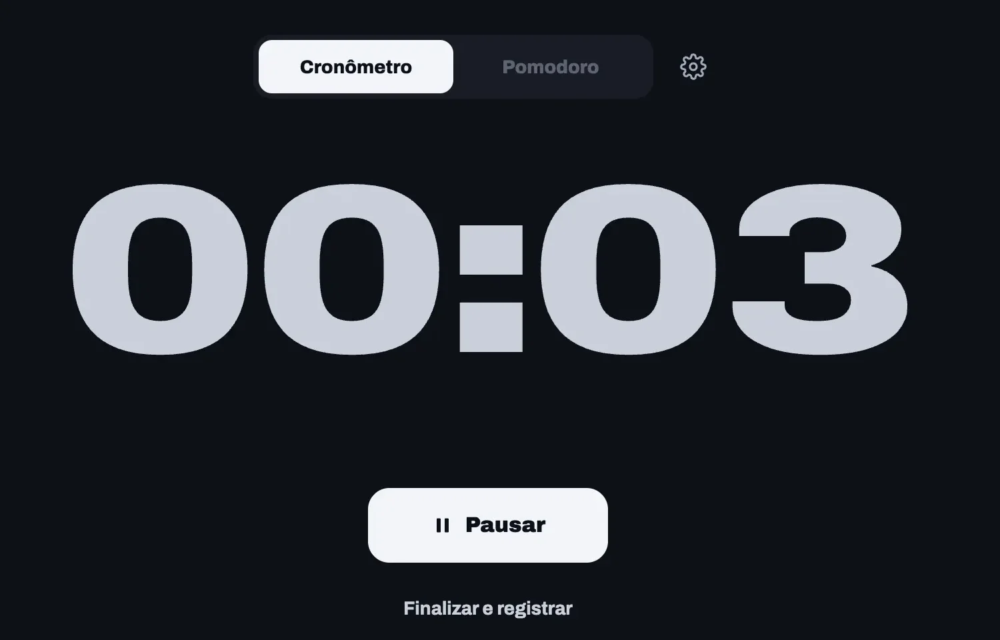
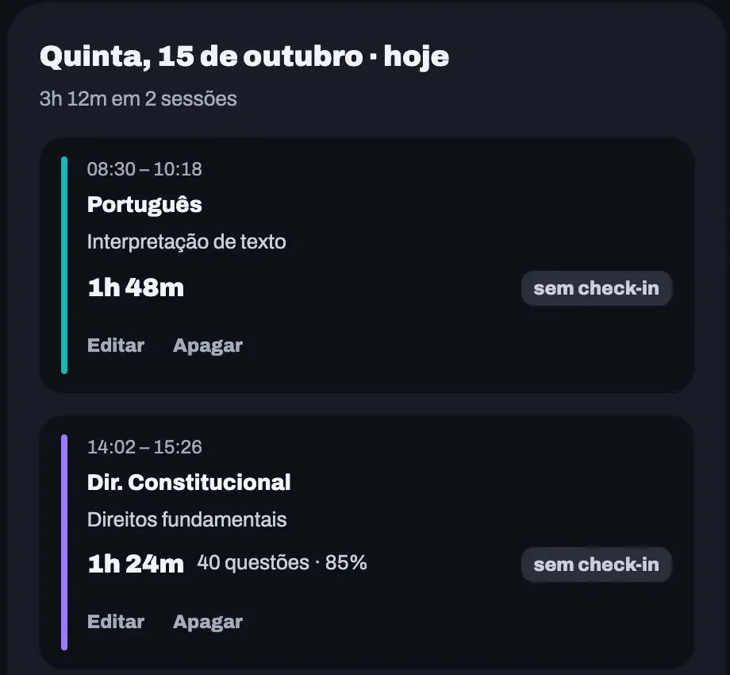
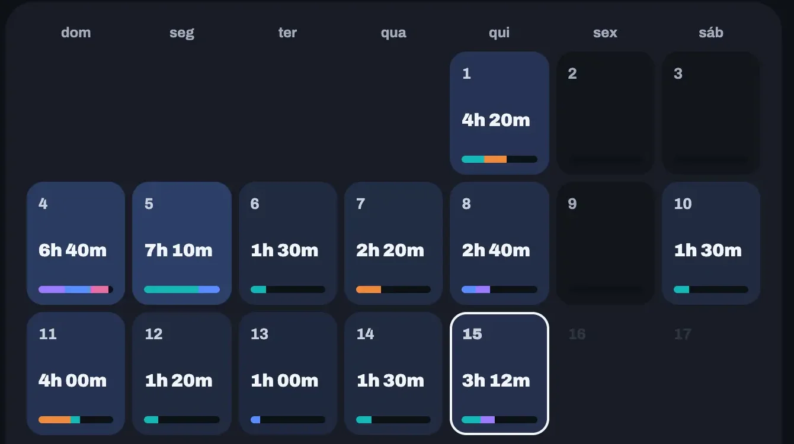

Você sentou às oito da manhã, levantou para almoçar e, à noite, tentou lembrar quanto estudou. Quatro horas? Cinco? Entre o café, o celular e aquela pausa que durou mais do que devia, o número que você anotou provavelmente não é o que aconteceu.

Registrar no fim do dia o que se estudou de manhã quase sempre dá errado. A conta sai arredondada para cima, a matéria que você evita some da lista e, no fim do mês, ninguém sabe para onde o tempo foi.

Registrar na hora resolve boa parte disso e dá menos trabalho do que parece. Vou mostrar como.

O resumo, se você tem dois minutos:

- Registre durante o estudo, com timer, e não de memória à noite.
- Anote matéria e assunto de cada sessão para os números servirem de algo.
- Pausa e distração ficam fora da conta: o que vale é a hora líquida.
- Esqueceu de ligar o timer? Dá para lançar a sessão depois, com dia e horário.
- Uma vez por semana, olhe o mês no calendário e ajuste o plano.

## Por que registrar horas de estudo?

Registrar as horas troca a sensação de ter estudado muito pelo número real, e com ele você decide a semana seguinte. Sem o registro, a tendência é repetir o que você já faz bem e adiar o que incomoda.

Para quem estuda para concurso, o desafio é o tamanho do edital. São dezenas de matérias, e a que mais pesa na prova nem sempre é a que mais recebe tempo. No ENEM, as áreas disputam o mesmo dia, e a redação costuma ficar para depois.

Com o tempo anotado por matéria, "acho que estudei pouca matemática" vira "foram duas horas em quatro semanas". É uma conversa bem diferente com você mesmo.

Se quiser medir mais do que o tempo, o artigo sobre [como monitorar o desempenho nos estudos](/blog/como-monitorar-o-desempenho-nos-estudos) mostra o que vale acompanhar.

## O que são horas líquidas?

Horas líquidas são o tempo em que você estudou de verdade, sem contar pausa, rede social, conversa ou o tempo de arrumar a mesa. Horas brutas são o tempo entre sentar e levantar.

A diferença costuma ser grande. Quem se senta por três horas e estuda duas teve um dia normal. O que atrapalha é registrar as três e planejar a semana como se todas contassem.

| | Horas brutas | Horas líquidas |
|---|---|---|
| O que conta | Do momento em que sentou até levantar | Só o tempo estudando |
| Pausas | Entram na conta | Ficam de fora |
| Serve para | Saber quanto da agenda foi ocupada | Planejar edital, revisão e simulado |
| Costuma vir de | Anotação no papel no fim do dia | Registro com timer |

O timer ajuda porque só soma o tempo em que está rodando. Quando você pausa, ele para, e retoma de onde parou.

## Como registrar com o timer

O jeito mais simples é usar o timer do [Estugram](https://estugram.com), que guarda a sessão com matéria e assunto e alimenta o histórico e as estatísticas. Funciona em quatro passos.

1. Abra o Timer e escolha o modo: cronômetro, que soma o tempo enquanto roda, ou Pomodoro, que alterna foco e pausa.
2. Clique em Iniciar e estude. Se precisar parar, use Pausar. O tempo parado não entra.
3. Ao terminar, clique em "Finalizar e registrar". O timer fica pausado enquanto você preenche.
4. Escolha a matéria e o assunto, informe as questões se resolveu alguma e salve.

Matéria e assunto são obrigatórios, porque é deles que saem as estatísticas por assunto. Se a matéria ainda não existe na sua lista, dá para cadastrar ali mesmo, junto com o assunto.

A janela de registro abre com a última matéria e o último assunto que você usou neste navegador. Se vai estudar a mesma coisa em várias sessões seguidas, é só confirmar e salvar.

*O timer rodando no modo cronômetro. As telas deste artigo são da nova versão do Estugram, que está em teste com um grupo de usuários, com dados de exemplo.*

### Cronômetro ou Pomodoro?

O cronômetro combina com um bloco de questões ou uma aula longa, quando você vai ficar um bom tempo no mesmo assunto. O Pomodoro ajuda quando o difícil é começar, ou quando você perde o fio depois de meia hora.

No Pomodoro, o foco padrão é de 25 minutos, a pausa curta de 5 e a longa de 15, a cada quatro ciclos. A pausa não conta como estudo, o que combina com o registro de horas líquidas. O artigo [como estudar usando o método Pomodoro](/blog/pomodoro) explica a técnica.

### E se a aba ficar em segundo plano?

O tempo continua certo. O timer guarda o horário de cada início e pausa e calcula o total a partir deles, em vez de contar segundo a segundo. Se o navegador congelar a aba enquanto você lê no papel, o total está certo quando você volta.

Sessões com menos de 60 segundos não são salvas, o que evita registro de clique sem querer.

## E se eu esquecer de ligar o timer?

Dá para lançar a sessão depois, direto no Histórico. Você informa matéria, assunto, o dia, a hora de início e a duração, e a sessão entra no calendário e nas estatísticas como se tivesse sido registrada na hora.

Serve para os dias em que você estudou no ônibus ou na biblioteca e só lembrou ao chegar em casa. A duração vai de 1 minuto a 10 horas por sessão. Se você estudou mais que isso, divida em duas.

Também dá para editar e apagar. Errou a matéria? Abra a sessão e corrija. Lançou duas vezes? Apague uma, e as estatísticas do dia são recalculadas.

*Clicando num dia do calendário, você vê as sessões com horário, assunto e questões, e pode editar ou apagar cada uma.*

Se você participa dos desafios com amigos, que também estão em teste com um grupo de usuários, há uma exceção: a sessão que já entrou num check-in só pode ser alterada depois que você apagar o check-in.

## Como usar o histórico na semana

O histórico mostra o mês em calendário, com o tempo estudado em cada dia e uma barra por matéria. Quanto mais azul o dia, mais horas ele tem. Os dias escuros ficaram sem estudo, e tudo bem: é só um dado para o planejamento.

*O calendário do mês: dias mais claros tiveram mais horas, e a barra de cada dia mostra as matérias estudadas.*

Uma revisão semanal de dez minutos, no domingo à noite ou na segunda cedo, já basta.

1. Olhe o resumo do mês: tempo total, dias com estudo e a média por dia estudado.
2. Filtre por uma matéria e veja em quais dias ela apareceu.
3. Procure a matéria que quase não aparece e dê a ela um bloco fixo na semana seguinte.
4. Confira os dias em que você estudou mais e anote o que eles tinham em comum: horário, lugar, tipo de tarefa.

### Um exemplo com concurso

Imagine quem estuda para um concurso com Português, Direito Constitucional, Raciocínio Lógico e Informática. Ao filtrar o mês, vê que Português apareceu em 14 dias e Raciocínio Lógico em 3.

Raciocínio Lógico precisa de dois blocos curtos por semana, em dias separados. Sem o registro, a impressão seria de que o tempo estava bem dividido.

Para que essa divisão se repita sem você pensar nela toda semana, o [ciclo de estudos](/blog/ciclo-de-estudos) alterna as matérias sem depender de grade fixa por dia.

## O registro alimenta as revisões

Quando você salva uma sessão com matéria e assunto, o Estugram monta as revisões a partir dela. O registro das horas passa a indicar também o que rever e quando.

As revisões automáticas seguem os intervalos de 24 horas, 7 e 30 dias, e ao salvar você também pode escolher uma data. A origem desses prazos está no artigo sobre o [método de revisão 24/7/30](/blog/revisao-24-7-30).

As questões e o acerto de cada sessão entram nas estatísticas por matéria. Informe, por exemplo, 30 questões resolvidas e 6 erradas: semanas depois, esse dado mostra qual assunto merece uma segunda passada.

## Erros comuns ao registrar horas

Os tropeços que mais atrapalham o hábito são pequenos.

- Deixar o timer rodando no almoço. Pause sempre que sair da mesa e, se esquecer, edite a sessão no Histórico.
- Dar o mesmo assunto genérico a tudo. Sem assunto específico, as estatísticas por assunto não mostram nada. Use o nome do capítulo ou do tópico do edital, sem descer a cada subitem.
- Olhar só o total. Dez horas na semana dizem pouco, mas dez horas com seis numa matéria só dizem bastante.
- Largar o hábito depois de um dia em branco. Lance o que lembrar e siga.

## Perguntas frequentes

### Quantas horas de estudo devo registrar por dia?

Não existe um número único: depende do seu tempo livre e do prazo da prova. Registre uma semana inteira sem mudar nada na rotina e use o total como ponto de partida para o plano. Só depois vale aumentar.

### Dá para lançar uma sessão esquecida?

Sim. No Histórico, use "Adicionar sessão" e informe matéria, assunto, dia, hora de início e duração. A sessão entra no calendário e nas estatísticas. O limite é de 10 horas por sessão, e o dia não pode estar no futuro.

### Timer é melhor que anotar no caderno?

Na maioria dos casos, sim: o timer para quando você pausa e não depende da memória. O caderno funciona se você anota início e fim na hora, mas a estimativa feita à noite tende a passar do que foi estudado. Para quem está começando, há também as [dicas para iniciantes em concursos](/blog/dicas-para-iniciantes-emconcursos).

### O que conta como hora de estudo?

Conta o tempo em que você lê, resolve questões, revisa ou resume com atenção na tarefa. Pausa, celular e conversa ficam de fora. Na dúvida, pergunte se você consegue dizer o que fez naquele intervalo. Se consegue, conta.

## Comece pela próxima sessão

Na próxima sessão, ligue o timer, estude e preencha matéria e assunto no fim. Faça isso por uma semana e depois abra o calendário do histórico. O número que aparecer costuma ser menor que o da sua cabeça, e é com ele que o plano da semana seguinte fica mais realista.

Se alguma parte do registro travou, escreva para ajuda@estugram.com e conte onde.

**[Comece a usar o Estugram](https://app.estugram.com/?utm_source=blog&utm_medium=artigo&utm_campaign=como-registrar-horas-de-estudo) e registre sua próxima sessão com matéria e assunto.**
