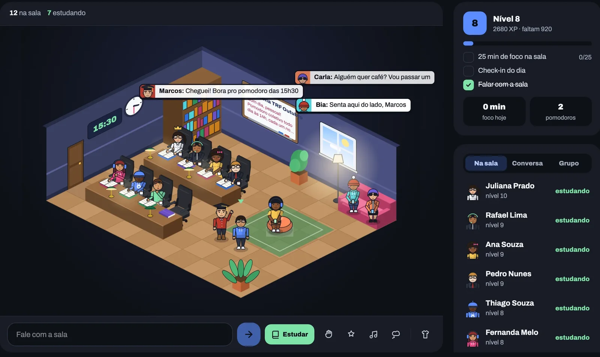

São oito da noite, o edital está aberto e o celular está ao lado da mesa. Você sabe o que precisa estudar. O difícil é começar, e a casa em silêncio não ajuda.

Na biblioteca, sentar é fácil: todo mundo ao redor já está sentado. Em casa, depois de um dia de trabalho, esse empurrão não vem de graça.

Uma sala de estudo online tenta devolver isso. Você entra, vê que tem gente estudando e começa a sua sessão. Aqui está como ela funciona no Estugram e o que a chamada de vídeo, liberada em novembro, muda.

O resumo, se você tem dois minutos:

- Sala de estudo online é estudar acompanhado, cada um com o seu material.
- No Estugram, sentar na mesa liga o timer e levantar pausa.
- A chamada começa com câmera e microfone desligados.
- Sem câmera, aparece o rosto do seu boneco no quadro.
- Cada sessão na sala vira registro de matéria e tempo.

## O que é uma sala de estudo online?

É um espaço virtual onde várias pessoas estudam ao mesmo tempo, sem precisar conversar. O que importa é saber que os outros também estão estudando.

Algumas salas são só chat, outras só vídeo, outras misturam os dois. A diferença está em quanto atrapalham. Uma sala boa fica no canto da tela e deixa você com o caderno.

No [Estugram](https://estugram.com), a sala faz parte de um desafio: quem participa do desafio entra na sala dele. Cada pessoa aparece como um boneco numa sala desenhada, com mesas e estantes de biblioteca.

## Como a sala funciona no Estugram?

Você entra, senta numa mesa e o timer começa a contar. Levantou, o timer pausa.

É o mesmo timer da página Timer, com cronômetro e Pomodoro. Por isso o tempo na sala não fica solto: ao terminar, você salva a sessão com matéria e assunto, e ela vai para o histórico como qualquer outra.

*A sala de um desafio, com dados de exemplo. Este print é da nova versão do Estugram, que está em teste com um grupo de usuários. Olhe o "12 na sala, 7 estudando" no topo e o botão Estudar na barra de baixo.*

Na lista da direita, quem está sentado com o timer rodando aparece como "estudando". O que você escreve no chat vira balão em cima do seu boneco, e a aba Conversa guarda o histórico. A aba Grupo mostra quem está no desafio mas não está na sala agora.

O painel também traz metas pequenas para o dia, como 25 minutos de foco na sala. Com o Pomodoro ligado, a pausa de 5 minutos continua correndo mesmo que você saia da mesa. Quem já usa o [método Pomodoro](/blog/pomodoro) só troca o cenário.

## O que muda com a chamada de vídeo?

Você passa a ver os outros estudando, e eles veem você. A chamada foi liberada em todas as salas em 18 de novembro, com até 20 pessoas por vez.

Os quadros ficam ao lado ou embaixo da sala, e os controles ficam na barra de baixo. O uso é o oposto de uma reunião: ninguém apresenta nada e ninguém precisa falar.

Quem tem vergonha da câmera costuma perguntar primeiro isto:

- Você entra com câmera e microfone desligados e liga só o que quiser.
- Com a câmera desligada, o quadro mostra o rosto do seu boneco.
- Quem está falando ganha uma borda verde, e o microfone desligado aparece ao lado do nome.
- Dá para ficar na sala sem entrar na chamada.

Muita gente aponta a câmera só para o caderno. Funciona igual: o que conta é saber que há gente do outro lado. Se a chamada estiver cheia, o app avisa, e você continua na sala com o timer, só sem o vídeo.

## Primeira sessão, passo a passo

Cabe numa sessão de 25 minutos.

1. Entre no desafio e abra a aba Sala.
2. Deixe o material à mão: caderno, bloco de questões ou a aula do dia.
3. Sente numa mesa ou clique em Estudar. O timer começa.
4. Se quiser companhia em vídeo, entre na chamada com a câmera desligada. Ligue depois, se der vontade.
5. Se precisar sair, levante da mesa: o timer pausa e você volta quando quiser.
6. Ao terminar, salve a sessão com matéria e assunto.

No chat, fique com o essencial: um "bom estudo" e o combinado do pomodoro das 15h30. A conversa de verdade espera o intervalo.

### Quando a sala não serve

Tem dia em que você precisa de silêncio total, ou de andar pela casa lendo um PDF. Nesses dias, use o timer normal, fora da sala. O registro é o mesmo, e o histórico não perde nada.

## Por que estudar acompanhado?

Porque sentar acompanhado custa menos do que sentar sozinho. Não conheço estudo para citar aqui, então vou ficar no que quem usa conta: começar é mais fácil quando já tem alguém sentado, e abrir o celular fica mais estranho com outras pessoas na tela.

Para quem estuda para concurso, a vantagem aparece na constância ao longo dos meses. Para quem prepara ENEM ou vestibular, a sala ajuda a fechar o bloco da matéria que se adia. Uma combinação que funciona é o [ciclo de estudos](/blog/ciclo-de-estudos) para decidir o que estudar e a sala para fazer.

## Como não deixar a sala distrair

A sala atrapalha quando vira lugar de conversa ou de comparação. Vale combinar algumas regras com o grupo:

- A chamada é de silêncio.
- O ranking é individual e serve para você ver a sua constância, então olhe de vez em quando, não a cada dez minutos.
- Para uma tarefa que exige muita concentração, como uma questão longa de cálculo, deixe a câmera desligada.
- Tire as notificações do celular antes de sentar.

Depois da sessão, o que você registrou também alimenta as revisões. O artigo sobre [como registrar horas de estudo](/blog/como-registrar-horas-de-estudo) mostra esse caminho.

## Perguntas frequentes

### Sala de estudo online é de graça?

No Estugram, sim: entrar em desafios, estudar na sala e usar a chamada não custa nada. A nova versão está em teste com um grupo de usuários, então confira no app o que está liberado para a sua conta.

### Preciso ligar a câmera?

Não. Você entra com câmera e microfone desligados e liga só o que quiser. Sem câmera, aparece o rosto do seu boneco no quadro. Também dá para ficar na sala sem entrar na chamada.

### Quantas pessoas cabem na chamada?

Até 20. Com a chamada cheia, o app mostra "Chamada cheia", e você continua na sala, estudando com o timer, sem a parte de vídeo.

### Posso criar uma sala só para os meus amigos?

Pode. Crie um desafio e mande o link no grupo: cada desafio tem a sua sala. Quem abre o link entra com a conta Google ou com um código enviado por e-mail. Como a nova versão ainda é por convite, o link é o caminho de entrada.

## Comece pela próxima sessão

Se o seu problema é começar, o primeiro bloco na sala resolve mais do que mais uma lista de dicas. Entre, sente, ligue o timer e fique 25 minutos. Se gostar, repita amanhã no mesmo horário.

Ficou com dúvida sobre a sala? Escreva para ajuda@estugram.com.

**[Comece a usar o Estugram](https://app.estugram.com/?utm_source=blog&utm_medium=artigo&utm_campaign=sala-de-estudo-online) e sente na sala na próxima sessão.**
